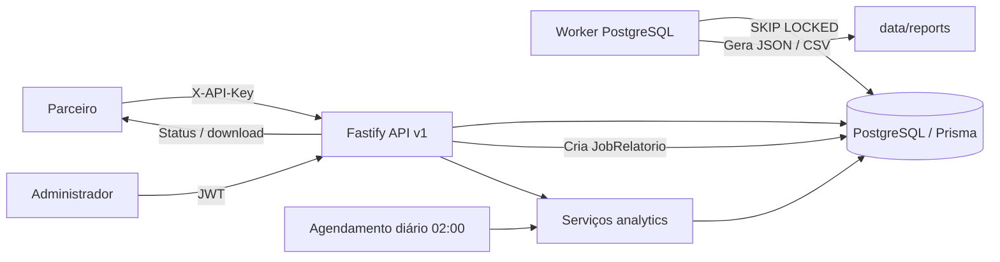

# Relatório técnico — GreenCode AV3

## 1. Visão da solução

A AV3 estende a API GreenCode da AV2 com análises operacionais, API pública versionada e geração assíncrona de relatórios. A aplicação usa TypeScript, Fastify, Prisma e PostgreSQL. O PostgreSQL também funciona como fila persistente dos relatórios; a solução atual não depende de Redis ou BullMQ.

## 2. Biblioteca estatística

Foi escolhida `simple-statistics` (`^7.8.8`) por oferecer as operações necessárias sem introduzir uma biblioteca matemática ampla:

- `mean` calcula médias de tempo e de valor recuperado.
- `standardDeviation` mede a variação do tempo de processamento.
- `linearRegression` estima a tendência de degradação física.

Os serviços de análise ficam em `src/services/analytics.service.ts` e consultam os registros por Prisma. A biblioteca recebe apenas as séries numéricas já preparadas pela aplicação.

## 3. Análises

### Eficiência operacional

Para cada lote ativo com triagem concluída, calcula-se `(triagemConcluidaEm - dataEntrada)` em horas. A resposta mostra média e desvio padrão por operador e por mês-calendário (`AAAA-MM`). Um grupo cujo tempo médio supera a média geral é sinalizado como gargalo. Lotes sem conclusão, com datas inválidas ou duração negativa não entram no cálculo.

### Rentabilidade por equipamento

Para cada equipamento ativo, usa-se a medição mais recente de recuperação não nula. O valor médio é agrupado por tipo, estado físico, marca e modelo. Cada grupo informa a quantidade de amostras para que médias com pouca observação sejam identificáveis.

### Vida útil remanescente

O sistema associa os estados físicos a uma escala ordinal (`NOVO` = 0 até `INSERVIVEL` = 6) e aplica regressão linear por mínimos quadrados às observações históricas datadas. O índice de degradação combina o estado físico observado com a depreciação relativa do valor estimado desde a primeira avaliação positiva. Quando há histórico de estado anterior, cada falha registrada acrescenta um avanço ordinal, limitado ao nível `INSERVIVEL`; como a base não padroniza severidade de falhas, esse peso é uma hipótese explícita do modelo. A projeção é o instante em que a reta ajustada atinge o nível `INSERVIVEL`. Equipamentos já inservíveis são marcados como tal; histórico insuficiente ou tendência sem piora resulta em projeção nula.

Essa previsão assume que a distância entre categorias é comparável, que uma falha equivale a um avanço ordinal e que a tendência observada continua. Ela serve como estimativa demonstrativa, não como garantia de vida útil. O seed tem poucos equipamentos, portanto não representa uma amostra estatística de produção.

## 4. Modelagem e histórico

| Modelo | Responsabilidade e dados principais |
| --- | --- |
| `Lote` | Recebimento, status, `triagemConcluidaEm` e `operadorTriagem`, necessários para medir eficiência. |
| `Movimentacao` | Linha do tempo de rastreabilidade, responsável e transições do equipamento. |
| `HistoricoValorEquipamento` | Medições temporais de valor estimado, valor recuperado e estado físico observado. Alimenta rentabilidade e o índice de depreciação usado na projeção. |
| `FalhaEquipamento` | Data, descrição e custo de falhas. A ocorrência entra na projeção como avanço ordinal, pois não existe severidade padronizada. |
| `ExecucaoAnalitica` | Tipo, parâmetros, início, conclusão e resultado JSON de cada execução. |
| `PrevisaoVidaUtil` | Uma previsão por equipamento e execução; armazena estado no cálculo, data prevista, data real observada e erro assinado em dias. |
| `ChaveApi` | Hash SHA-256, parceiro, permissões, estado ativo e datas. A chave em texto claro só é devolvida ao criá-la ou rotacioná-la. |
| `JobRelatorio` | Fila persistente, formato, parceiro, status, parâmetros, resultado, erro, arquivo, tentativas, horário do próximo retry e lease do worker. |

As migrations ficam em `prisma/migrations`. `PrevisaoVidaUtil.dataReal` e `erroDias` são preenchidos quando uma medição posterior registra `INSERVIVEL`; erro positivo significa que a ocorrência real foi posterior à data prevista, e erro negativo significa que foi anterior.

## 5. API e segurança

As rotas de integração usam `/api/v1/public`; as operações internas e administrativas usam `/api/v1/internal`. Rotas internas exigem JWT e respeitam os papéis ou o papel de administrador definido por operação. Rotas públicas usam `X-API-Key`, permissões por chave e rate limit de 120 requisições por minuto por chave. Os caminhos antigos da AV2 continuam disponíveis como aliases protegidos para compatibilidade; novas integrações devem usar as rotas versionadas. A retirada de qualquer alias legado será anunciada com pelo menos 90 dias de antecedência.

Permissões disponíveis:

- `rastreabilidade:read`
- `lotes:write`
- `analises:read`

Cada chave fica associada ao parceiro e os jobs e downloads são consultados no escopo desse parceiro. O contrato OpenAPI fica no Swagger (`/docs`) e traz exemplos completos de corpos de entrada e respostas de sucesso, além de exemplos dos erros de autenticação, permissão, validação, conflito, limite e estado do job.

### Depreciação de versões

A política adotada é manter uma versão por pelo menos 12 meses após a publicação da versão seguinte. A data de remoção será anunciada com pelo menos 90 dias de antecedência. O aviso deve indicar rotas afetadas, alternativa de migração e data final; durante o período, a versão antiga continua disponível.

## 6. Processamento assíncrono, retry e dead-letter

O `POST /api/v1/public/relatorios` grava um job `PENDENTE` no PostgreSQL e responde `202` com identificador. Um worker separado (`npm run worker`) reivindica jobs usando `FOR UPDATE SKIP LOCKED`, evitando que dois workers peguem a mesma linha. O cliente consulta `GET /api/v1/public/relatorios/:id` e baixa o arquivo em `GET /api/v1/public/relatorios/:id/download` quando o status é `CONCLUIDO`.

O worker aceita concorrência configurável, renova uma lease enquanto processa e devolve jobs à fila se uma lease expirar. Há até cinco tentativas totais. Após cada falha não final, o próximo horário usa backoff exponencial de 1, 2, 4 e 8 segundos. Depois da quinta falha, o job fica com status `FALHOU`; esses registros formam a dead-letter persistida no PostgreSQL e são listados em `/api/v1/internal/relatorios/dead-letter`. A dead-letter é inspecionada manualmente; não há reprocessamento automático.

Os arquivos são gravados em `data/reports` por padrão, ou no caminho definido em `REPORTS_DIR`. O formato pode ser `JSON` ou `CSV`.

## 7. Escala para centenas ou milhares de parceiros

- **API horizontal:** executar réplicas stateless atrás de um balanceador; cada chamada valida chave e permissões no banco/cache.
- **Workers horizontais:** iniciar vários workers e aumentar `REPORT_WORKER_CONCURRENCY`. `SKIP LOCKED` distribui os jobs entre processos; dimensionar pool de conexões para não saturar o PostgreSQL.
- **Índices e particionamento:** manter índices por status/próxima execução e por parceiro/data. Com histórico grande, particionar medições, execuções e movimentações por data, preservando consultas recentes eficientes.
- **Cache:** armazenar agregados analíticos por parceiro e período com invalidação após novas medições; evitar recalcular séries extensas em cada chamada.
- **Leituras:** usar réplicas de leitura para consultas históricas e relatórios pesados, mantendo gravações, reivindicação de jobs e atualização de status no primário.
- **Limites por plano:** trocar o limite fixo atual por cotas configuráveis por plano, parceiro e janela, sem remover limites de segurança por chave.
- **Agendamento:** o cron diário está no processo da API. Ao escalar réplicas, garantir execução única por horário com advisory lock no PostgreSQL ou mover o agendamento para um worker singleton.
- **Arquivos:** transferir arquivos de relatório para armazenamento de objetos compartilhado entre réplicas e usar URLs temporárias de download.

## 8. Endpoints relevantes

| Método e rota | Uso |
| --- | --- |
| `GET /api/v1/internal/analises/eficiencia` | Executar análise de eficiência e persistir resultado. |
| `GET /api/v1/internal/analises/rentabilidade` | Executar análise de rentabilidade e persistir resultado. |
| `GET /api/v1/internal/analises/vida-util` | Gerar projeções e comparações de vida útil. |
| `GET /api/v1/internal/analises/historico` | Consultar execuções analíticas anteriores. |
| `GET /api/v1/internal/analises/vida-util/comparacoes` | Consultar previsões e resultados observados. |
| `POST /api/v1/public/relatorios` | Enfileirar relatório JSON ou CSV. |
| `GET /api/v1/public/relatorios/:id` | Fazer polling do status do job. |
| `GET /api/v1/public/relatorios/:id/download` | Baixar arquivo concluído. |
| `GET /api/v1/internal/relatorios/dead-letter` | Inspecionar jobs que esgotaram tentativas. |

## 9. Verificações realizadas

- O schema Prisma e o build TypeScript foram validados no ambiente Windows de desenvolvimento.
- O workflow `.github/workflows/compatibilidade.yml` foi configurado para executar validação e build em Windows Server 2022 e Ubuntu 24.04 em cada push ou pull request; esta execução local não pode atestar resultados futuros do workflow.
- Os endpoints analíticos foram consultados manualmente anteriormente: eficiência, rentabilidade, vida útil, histórico e comparações retornaram HTTP 200. Essa execução usou a projeção anterior; a versão atual também precisa ser consultada com o banco disponível.
- O fluxo público de relatórios havia sido consultado manualmente com BullMQ. O worker PostgreSQL substituiu aquela implementação; o status da migration `fila_jobs_postgres` e o fluxo POST, polling e download devem ser conferidos no banco local antes da entrega.
- A documentação define Windows 10 ou superior e Linux Ubuntu 24.04.3 ou superior e derivados como plataformas-alvo. A validação local desta versão foi feita somente no Windows; o workflow configurado permitirá confirmar também o build no runner Linux após o próximo push ou pull request.
